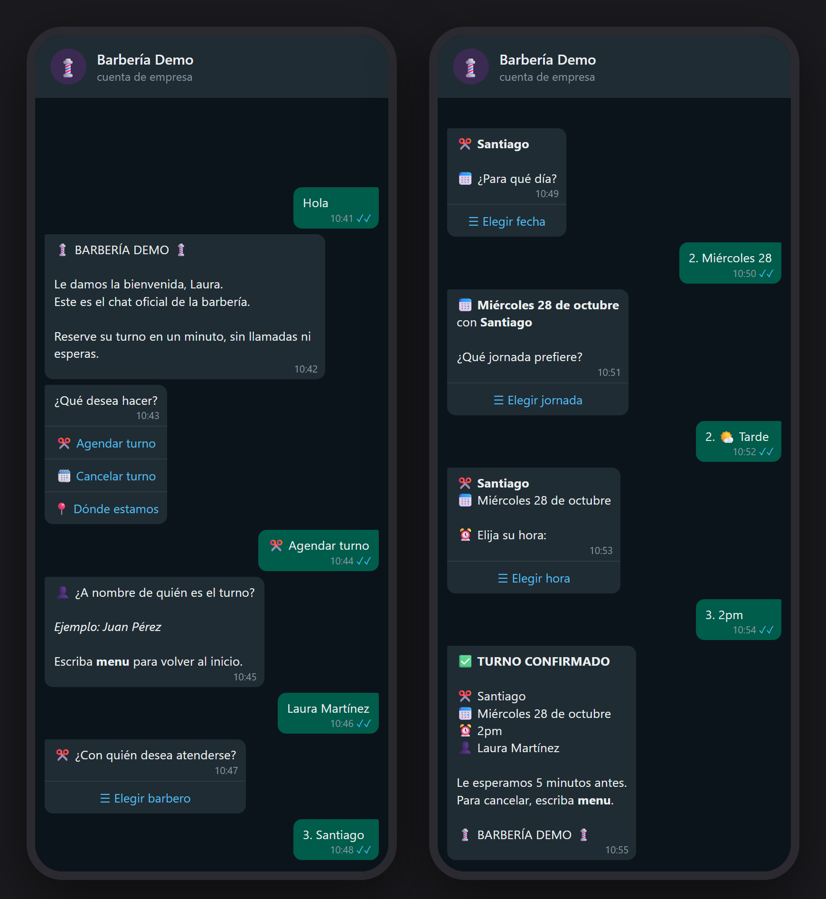
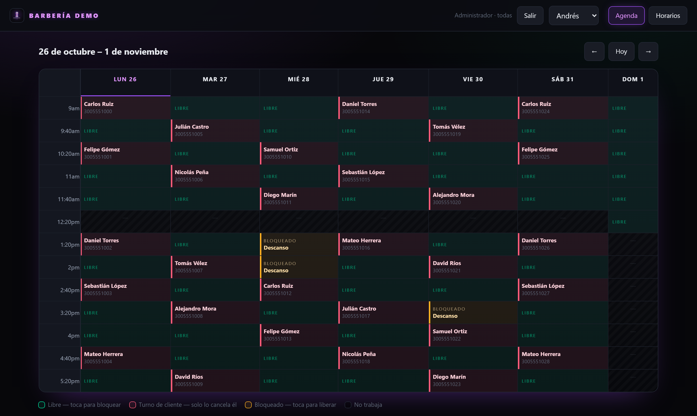
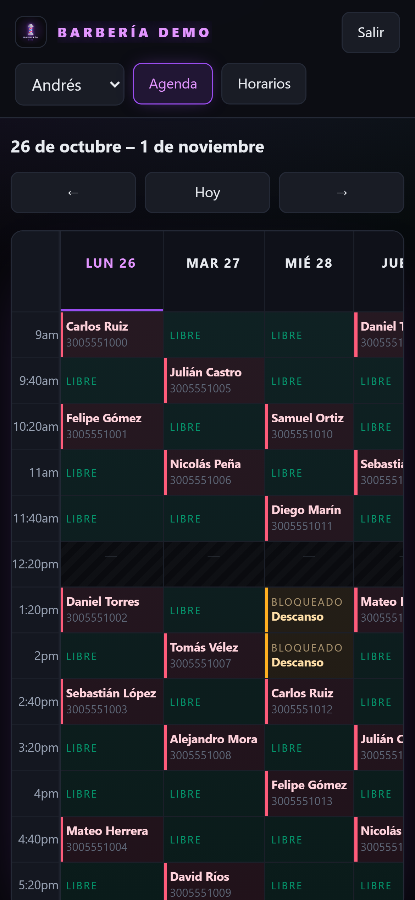
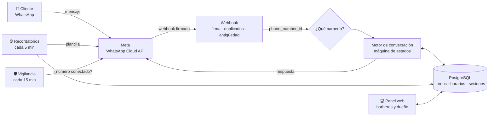

# 💈 Chatbot de agendamiento por WhatsApp para barberías

**Los clientes reservan, cancelan y reciben recordatorios de su turno por WhatsApp, sin llamar ni esperar respuesta.** Un solo sistema atiende a varias barberías a la vez, y cada barbero administra su agenda desde un panel web.

> 🟢 **En producción** desde septiembre de 2026, atendiendo clientes reales de una barbería en Colombia.




<sub>*Conversación generada por el bot real, corriendo con datos de demostración.*</sub>

---

## El problema

En una barbería de barrio los turnos se piden por WhatsApp personal o por llamada. El barbero contesta entre corte y corte, los clientes esperan respuesta, se cruzan citas y nadie recuerda a nadie su turno.

## La solución

| Para el cliente | Para el barbero | Para el dueño |
|---|---|---|
| Agenda en ~1 minuto, a cualquier hora | Aviso inmediato de cada turno nuevo o cancelado | Un panel con la agenda de todos |
| Elige barbero, día y hora en menús | Panel web para ver su semana y bloquear descansos | Horarios editables sin tocar código |
| Recordatorio automático 1 hora antes | Su agenda también por WhatsApp | Varias barberías, un solo despliegue |
| Cancela él mismo, sin llamar | Solo ve su propia agenda | Alertas si algo deja de funcionar |

## Capturas

**Panel web — agenda semanal del barbero**



<table>
<tr>
<td width="38%"></td>
<td>

**Diseñado para usarse en el celular**, que es donde lo usa el barbero: la columna de horas queda fija al desplazarse y cada estado tiene su color:

- 🟢 **Libre** — tocándolo se bloquea (almuerzo, diligencia)
- 🔴 **Turno de cliente** — con nombre y teléfono
- 🟠 **Bloqueado** — tocándolo se libera
- ⬛ **No trabaja** a esa hora

El dueño ve las agendas de todos; cada barbero, solo la suya.

</td>
</tr>
</table>

---

## Arquitectura



**Multi-tenant por diseño.** Meta incluye en cada mensaje el `phone_number_id` del número que lo recibió. Con eso el sistema sabe a qué barbería pertenece: **una barbería nueva es una fila en la base, no un despliegue nuevo.**

---

## Decisiones técnicas destacadas

### 1. La doble reserva es imposible, no "poco probable"
Dos clientes pueden tocar la misma hora en el mismo segundo. En vez de comprobar disponibilidad y luego escribir (lo que deja una ventana entre ambas cosas), la base de datos **físicamente no puede** guardar dos turnos confirmados iguales:

```sql
CREATE UNIQUE INDEX ux_turno_ocupado
  ON turnos (barbero_id, fecha, hora)
  WHERE estado = 'Confirmado';
```
El segundo `INSERT` falla con `23505` y el bot le ofrece otra hora. Sin condiciones de carrera.

### 2. Adaptado al cambio de WhatsApp de 2026: usuarios sin número
En 2026 WhatsApp lanzó los **nombres de usuario**, que permiten ocultar el número de teléfono. Para esos clientes Meta ya no envía el teléfono sino un identificador nuevo (*Business-Scoped User ID*), y responderles exige otro campo en la API. Un bot que solo lee el teléfono los deja sin respuesta, en silencio.

Detecté el caso en producción con los registros, lo reproduje con el mensaje real y lo resolví en una sola puerta de salida ([`identidad.js`](src/servicios/identidad.js)), así que cubre texto, menús y plantillas por igual.

### 3. El webhook tiene cuatro defensas
- **Firma HMAC-SHA256** calculada sobre el cuerpo *crudo* (re-serializar el JSON cambia los bytes y la firma nunca coincide).
- **Responde `200` antes de procesar**: si Meta espera, da la entrega por fallida y reenvía, y el cliente recibe respuestas duplicadas.
- **Deduplicación** por id de mensaje.
- **Descarta mensajes viejos** que Meta suelta de golpe tras una caída.

### 4. Todo se calcula en la zona horaria del negocio
El servidor corre en UTC: entre las 7 p.m. y la medianoche en Colombia ya es "mañana" para él. Todas las fechas y horas se calculan en la zona de cada barbería, y **los 18 festivos colombianos se calculan solos** (Ley Emiliani y fecha de Pascua): no hay tablas que actualizar cada año.

### 5. Respeta los límites de WhatsApp
Una lista de WhatsApp admite máximo 10 opciones, y si se pasa **Meta rechaza el mensaje entero sin avisar**. Toda lista pasa por una sola función que garantiza el tope; cuando un día tiene muchos turnos, el bot los reparte en mañana / tarde / tarde-noche.

### 6. Vigilancia contra el fallo silencioso
El peor fallo de un bot es que deje de recibir mensajes mientras el servidor responde bien. Cada 15 minutos el sistema le pregunta a Meta si el número sigue conectado y si los mensajes siguen llegando a esta dirección, y lo expone en `/salud` para un monitor externo.

### 7. Seguridad
- Contraseñas con **scrypt** y comparación de tiempo constante.
- Sesión del panel en **cookie firmada** (`HttpOnly`, `SameSite`, `Secure`).
- Cada ruta del panel verifica que el usuario tenga derecho **a ese barbero y esa barbería**: cambiar un id en la petición no da acceso a otra agenda.
- **Row Level Security** activo en todas las tablas.
- Freno de intentos fallidos de inicio de sesión.

---

## Stack

| | |
|---|---|
| **Backend** | Node.js 22 (ESM), Express 5 |
| **Base de datos** | PostgreSQL (Supabase en producción) |
| **Mensajería** | WhatsApp Cloud API de Meta — mensajes interactivos y plantillas |
| **Panel** | HTML, CSS y JavaScript sin frameworks ni dependencias |
| **Pruebas** | Corredor nativo de Node (`node --test`), sin librerías |
| **Despliegue** | Railway, con despliegue automático desde GitHub |

**Solo 3 dependencias:** `express`, `pg` y `dotenv`.

---

## Correrlo en local

No necesita cuenta de Meta: **sin `API_TOKEN` el bot corre en modo simulado** y guarda lo que habría enviado en vez de enviarlo.

```bash
git clone https://github.com/diaz021/chatbot-barberias-whatsapp.git
cd chatbot-barberias-whatsapp
npm install

docker compose up -d          # Postgres local
cp .env.example .env
npm run migrar                # crea las tablas y la "Barbería Demo"

npm start &                   # (8 pruebas del panel necesitan el servidor)
npm test                      # 179 pruebas
npm run clave -- --admin "573001234567" "una-clave"
# panel en http://localhost:3000/panel
```

## Pruebas

**179 pruebas automáticas**, que corren contra una base de datos real (no simulada): conversaciones completas de punta a punta, la defensa contra la doble reserva, los límites de WhatsApp, el aislamiento entre barberías en el panel, el cálculo de festivos, la firma del webhook y los casos reales que fallaron en producción, reproducidos con el mensaje exacto que los causó.

---

## Estructura

```
src/
├── app.js              servidor, /salud y apagado limpio
├── config/             variables, fechas en zona del negocio, festivos
├── webhook/            entrada de Meta: firma, defensas, remitente
├── motor/              la conversación: agendar, cancelar, panel del barbero
├── mensajes/           toda la voz del bot y los topes de WhatsApp
├── servicios/          turnos, horarios, recordatorios, vigilancia, acceso
└── panel/              panel web
db/                     migraciones SQL y semilla de demostración
tests/                  179 pruebas
```

---

<details>
<summary><b>English summary</b></summary>

A WhatsApp booking bot for barbershops, **live in production since September 2026** with real customers in Colombia. Customers book, cancel and get reminders through WhatsApp menus; barbers manage their week from a mobile-first web panel.

- **Multi-tenant**: one deployment serves many barbershops, routed by Meta's `phone_number_id`.
- **Double booking is impossible** by design: a partial unique index in PostgreSQL.
- **Adapted to WhatsApp's 2026 usernames**: handles users who hide their phone number (Business-Scoped User IDs).
- Webhook hardened with HMAC signature validation, deduplication and replay protection.
- Timezone-correct scheduling and computed Colombian public holidays.
- 179 automated tests against a real database; only 3 runtime dependencies.

Stack: Node.js 22, Express 5, PostgreSQL, WhatsApp Cloud API, Railway.
</details>

---

**Autor:** [Juan Esteban Díaz](https://github.com/diaz021)

<sub>Código publicado como muestra de portafolio. Los datos de este repositorio (barbería, barberos, clientes y teléfonos) son ficticios.</sub>
